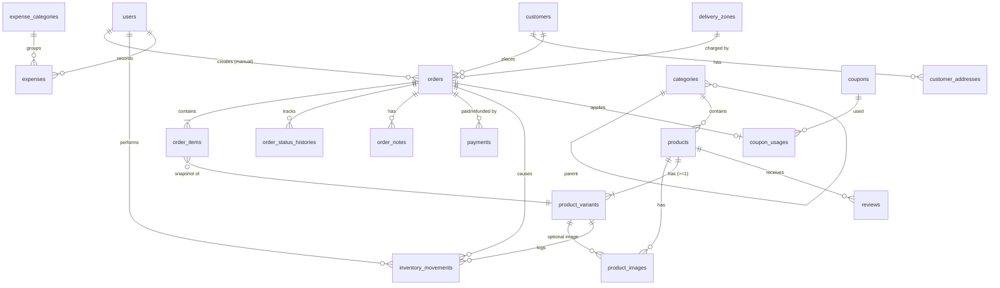

# Nakshazz — Phase 2: Database Schema & ER Diagram

Status: **DRAFT — awaiting owner approval**
Engine: MariaDB ≥ 10.6, InnoDB, `utf8mb4_unicode_ci`
Timezone: app `Asia/Dhaka`, DB stores UTC `TIMESTAMP`
Money: `DECIMAL(12,2)` everywhere. Quantities: `INT`.

---

## 1. Conventions

- PK `id BIGINT UNSIGNED AUTO_INCREMENT`.
- FK names `<table>_id`. Default `ON DELETE RESTRICT` (history must never vanish).
- Nothing referenced by an order is hard-deleted → products/variants use `status`/`is_active` (archive).
- Enums stored as `VARCHAR(30)` + PHP backed Enum (easier to extend than MySQL `ENUM`).
- `created_at`, `updated_at` on all tables unless noted (ledger tables: `created_at` only, immutable).

---

## 2. ER Diagram



Supporting (no relations): `banners`, `pages`, `store_settings`, `contact_messages`.

---

## 3. Tables

### 3.1 Auth & People

**users** (admin / staff)
| column | type | notes |
|---|---|---|
| name | varchar(100) | |
| email | varchar(150) | unique |
| password | varchar(255) | bcrypt |
| role | varchar(20) | `owner` \| `staff` |
| is_active | bool | default true |
| last_login_at | timestamp null | |

**customers** — auto-created at checkout / manual sale, keyed by phone
| column | type | notes |
|---|---|---|
| name | varchar(100) | |
| phone | varchar(14) | **unique**, normalized `01XXXXXXXXX` |
| email | varchar(150) null | |
| notes | text null | internal |

Total purchases / order count computed by query (no cached counters).

**customer_addresses**
| column | type | notes |
|---|---|---|
| customer_id | FK customers | cascade delete |
| address_line | varchar(255) | |
| area | varchar(100) | |
| city | varchar(100) | |
| delivery_zone_id | FK null | |
| is_default | bool | |

**delivery_zones**
| column | type | notes |
|---|---|---|
| name | varchar(50) | seed: Inside Dhaka, Outside Dhaka |
| charge | decimal(12,2) | admin-editable |
| is_active | bool | |
| sort_order | smallint | |

---

### 3.2 Catalog

**categories**
| column | type | notes |
|---|---|---|
| parent_id | FK categories null | one level deep is enough (e.g. Earrings → Jhumka) |
| name, slug | varchar | slug unique |
| description | text null | |
| image_path | varchar null | |
| is_active, sort_order | | |
| seo_title, seo_description | varchar null | |

**products**
| column | type | notes |
|---|---|---|
| category_id | FK | index |
| name | varchar(150) | index |
| slug | varchar(170) | unique |
| short_description | varchar(300) null | |
| description | text | |
| status | varchar(20) | `draft` \| `active` \| `archived`; index |
| is_featured | bool | index with status |
| is_made_to_order | bool | |
| preparation_days | smallint null | shown on product page |
| seo_title, seo_description | varchar null | |

Best sellers = derived from `order_items`. New arrivals = `created_at`.

**product_variants** (every product ≥ 1; holds price, cost, stock)
| column | type | notes |
|---|---|---|
| product_id | FK | |
| sku | varchar(60) | **unique** |
| title | varchar(150) | e.g. "Gold / Size 7" or "Default" |
| options | JSON | `{"Color":"Gold","Size":"7","Material":"Brass"}` |
| price | decimal(12,2) | selling price |
| compare_at_price | decimal(12,2) null | strike-through "was" price |
| raw_material_cost | decimal(12,2) | |
| labour_cost | decimal(12,2) | |
| packaging_cost | decimal(12,2) | |
| other_cost | decimal(12,2) | |
| total_cost | decimal(12,2) | = sum of 4, set by model on save |
| stock_on_hand | int (signed) | negative only if `allow_backorder` |
| stock_reserved | int unsigned | held by unshipped orders |
| low_stock_threshold | int null | null → store setting |
| allow_backorder | bool | true for made-to-order |
| is_default | bool | |
| is_active | bool | |
| sort_order | smallint | |

Available = `stock_on_hand − stock_reserved`. Sold qty = sum of `sale` movements.

**product_images**
| column | type | notes |
|---|---|---|
| product_id | FK | cascade |
| variant_id | FK null | set null; color-specific photo |
| path | varchar | original WebP; thumbnails generated (`_sm`, `_md`, `_lg`) |
| alt | varchar null | |
| sort_order | smallint | |
| is_primary | bool | |

**inventory_movements** (immutable ledger — never updated/deleted)
| column | type | notes |
|---|---|---|
| variant_id | FK | index (variant_id, created_at) |
| type | varchar(30) | see below |
| on_hand_delta | int | signed |
| reserved_delta | int | signed |
| on_hand_after | int | snapshot after change |
| reserved_after | int | |
| order_id | FK null | index |
| order_item_id | FK null | |
| reason | varchar(255) null | required for adjustments |
| user_id | FK null | null = system/website |
| created_at | timestamp | |

Movement types:
| type | on_hand | reserved |
|---|---|---|
| `purchase` (restock/production) | + | |
| `adjustment_in` / `adjustment_out` | ± | |
| `reserve` (website order placed) | | + |
| `release` (cancelled before ship) | | − |
| `sale` (shipped, or manual sale handed over) | − | − (if was reserved) |
| `return` (back to sellable stock) | + | |
| `return_damaged` (written off) | 0 | — logged for audit only |

---

### 3.3 Orders (website + manual — single path, R1)

**orders**
| column | type | notes |
|---|---|---|
| uuid | char(36) | unique; public tracking link |
| order_number | varchar(20) | unique; `NK` + padded id, e.g. `NK100245` |
| source | varchar(20) | `website` \| `manual` |
| channel | varchar(20) | `website` \| `facebook` \| `whatsapp` \| `physical_store` \| `other` |
| status | varchar(20) | see §4; index |
| payment_status | varchar(30) | `unpaid` \| `pending_verification` \| `partially_paid` \| `paid` \| `partially_refunded` \| `refunded` |
| payment_method | varchar(30) | intended method (see payments) |
| customer_id | FK null | null allowed for walk-in manual sale |
| customer_name | varchar(100) null | snapshot |
| customer_phone | varchar(14) null | snapshot; index |
| customer_email | varchar(150) null | |
| shipping_address | varchar(255) null | snapshot |
| shipping_area, shipping_city | varchar(100) null | |
| delivery_zone_id | FK null | |
| delivery_zone_name | varchar(50) null | snapshot |
| items_subtotal | decimal(12,2) | Σ unit_price × qty |
| coupon_discount | decimal(12,2) | |
| manual_discount | decimal(12,2) | admin-given (POS / phone deal) |
| delivery_charge | decimal(12,2) | charged to customer |
| grand_total | decimal(12,2) | subtotal − discounts + delivery_charge |
| cogs_total | decimal(12,2) | Σ snapshot cost × qty |
| delivery_cost | decimal(12,2) null | actual courier cost (entered by admin) |
| coupon_id | FK null | |
| coupon_code | varchar(40) null | snapshot |
| courier_name | varchar(50) null | Steadfast / Pathao / RedX / own |
| tracking_code | varchar(100) null | |
| customer_note | text null | |
| created_by | FK users null | set for manual sales |
| ip_address | varchar(45) null | abuse/rate-limit audit |
| placed_at | timestamp | index (channel, placed_at) |
| confirmed_at, shipped_at, delivered_at, cancelled_at, returned_at | timestamp null | `delivered_at` indexed (realized-profit date) |

**order_items** (all snapshots — reports read only these)
| column | type | notes |
|---|---|---|
| order_id | FK | cascade |
| product_id | FK null | set null on delete (never expected) |
| variant_id | FK null | set null |
| product_name | varchar(150) | snapshot |
| variant_title | varchar(150) | snapshot |
| sku | varchar(60) | snapshot |
| unit_price | decimal(12,2) | snapshot |
| unit_cost | decimal(12,2) | snapshot total cost |
| cost_breakdown | JSON | `{raw, labour, packaging, other}` snapshot |
| quantity | int | |
| line_subtotal | decimal(12,2) | unit_price × qty |
| discount_allocated | decimal(12,2) | order discounts spread pro-rata → product-wise profit stays correct |
| line_total | decimal(12,2) | subtotal − discount_allocated |
| returned_quantity | int | default 0 |
| damaged_quantity | int | default 0; subset of returned, cost becomes loss |

**order_status_histories**: order_id, from_status null, to_status, user_id null, note null, created_at.

**order_notes** (internal): order_id, user_id, body text, created_at.

**payments** (payments and refunds; SSLCommerz-ready)
| column | type | notes |
|---|---|---|
| order_id | FK | index |
| type | varchar(10) | `payment` \| `refund` |
| method | varchar(30) | `cod` \| `cash` \| `bkash` \| `mobile_banking` \| `bank_transfer` \| `online_gateway` \| `other` |
| amount | decimal(12,2) | always positive |
| fee | decimal(12,2) | courier COD charge, bKash cash-out cost, gateway fee |
| transaction_id | varchar(60) null | bKash TrxID / gateway ref |
| sender_number | varchar(14) null | bKash sender |
| status | varchar(20) | `pending` \| `verified` \| `rejected` |
| refund_reason | varchar(20) null | `return` \| `compensation` |
| verified_by | FK users null | |
| verified_at, paid_at | timestamp null | |
| gateway_payload | JSON null | SSLCommerz later |
| note | varchar(255) null | |
| created_by | FK users null | |

Unique index `(method, transaction_id)` → same bKash TrxID can never be used twice.

**coupons**
| column | type | notes |
|---|---|---|
| code | varchar(40) | unique, stored uppercase |
| type | varchar(10) | `fixed` \| `percent` |
| value | decimal(12,2) | |
| max_discount | decimal(12,2) null | cap for percent |
| min_order_amount | decimal(12,2) null | on items subtotal |
| starts_at, expires_at | timestamp null | |
| usage_limit | int null | total |
| per_phone_limit | int null | stops one person reusing |
| used_count | int | incremented under row lock |
| is_active | bool | |

**coupon_usages**: coupon_id, order_id (unique), customer_phone, discount_amount, created_at. Deleted + `used_count` decremented if order cancelled.

---

### 3.4 Expenses

**expense_categories**: name, slug, hint (shown in form, e.g. "Per-order courier cost goes on the order, not here"), is_active.
Seed: Marketing, Packaging (bulk), Delivery (non-order), Utilities, Rent, Salary, Other.

**expenses**: expense_category_id, title, amount decimal, expense_date date (index), description text null, attachment_path null, created_by FK users.

---

### 3.5 Content & Settings

**reviews**: product_id null (null = store review), order_id null (verified buyer), customer_name, rating tinyint 1–5, comment text, source `website` \| `facebook` \| `instagram` (admin can import existing FB reviews), status `pending` \| `approved` \| `rejected`, is_featured (homepage).

**banners**: title, subtitle null, image_path, mobile_image_path null, link_url null, button_text null, placement `hero` \| `promo`, sort_order, is_active, starts_at null, ends_at null.

**pages**: slug unique (`about`, `privacy-policy`, `return-refund-policy`, `delivery-policy`), title, body (markdown), seo_title, seo_description, updated_by.

**store_settings**: `key` varchar(80) PK, `value` JSON, `is_public` bool (only public keys served to storefront).
Keys: store_name, logo_path, phone, whatsapp_number, email, address, facebook_url, instagram_url, currency (`BDT`), low_stock_threshold, cod_enabled, bkash_enabled, bkash_number, bkash_account_type (`personal`/`merchant`), bkash_instructions, order_prefix.

**contact_messages**: name, phone, email null, message, is_read, ip_address.

Laravel defaults kept: `sessions`, `cache`, `jobs`, `failed_jobs`, `password_reset_tokens`, `personal_access_tokens`.

Dropped from brief: `sales`, `sale_items`, `inventory` (see R1/R3), newsletter (homepage uses Facebook/Instagram section instead).

---

## 4. Order Status Rules

```
pending ──▶ confirmed ──▶ processing ──▶ shipped ──▶ delivered
   │            │             │             │            │
   └──▶ cancelled ◀───────────┘             └──▶ returned ◀┘
```

| From → To | Stock | Notes |
|---|---|---|
| (new website order) → pending | `reserve` | |
| pending/confirmed/processing → cancelled | `release` | coupon usage freed |
| confirmed/processing → shipped | `sale` | courier + tracking optional |
| shipped → delivered | — | COD payment row created (verified) → **realized** |
| shipped → returned | `return` / `return_damaged` | customer refused at door; delivery_cost still a loss |
| delivered → returned | same | refund row if money was paid |
| Partial return (delivered) | per item | status stays delivered; `returned_quantity` updated |

Manual sale: created directly as `delivered` (`sale` movement immediately) **or** as `confirmed` if it must be couriered (Facebook/WhatsApp order) → then normal flow.

Terminal: `cancelled`, `returned`.

---

## 5. bKash Manual Payment Flow

1. Checkout: customer picks bKash → sees store bKash number, account type, amount, instructions.
2. Customer sends money → enters **sender number + TrxID** → order `pending`, payment row `pending`, order `payment_status = pending_verification`.
3. Admin opens order, matches TrxID + amount against bKash app → **Verify** (optional fee for cash-out cost) or **Reject**.
4. Verified → `payment_status = paid`. Rejected → stays unpaid; staff calls customer.

Duplicate TrxID rejected by DB unique index. Later SSLCommerz = new `PaymentGateway` class writing to same `payments` table.

> Note: bKash's terms say business payments should go to a **Merchant** account. A Personal account works for now but is riskier for volume. A Merchant account also makes the later move to an automated gateway easier.

---

## 6. Profit Calculation Rules (no double counting)

Per item (only from snapshots):
```
net_qty        = quantity − returned_quantity
item_revenue   = line_total × net_qty / quantity
item_cogs      = unit_cost × (net_qty + damaged_quantity)   // damaged returns are a loss
item_gross     = item_revenue − item_cogs
```

Report for a date range:
```
Product revenue   = Σ item_revenue
Discounts         = Σ (coupon_discount + manual_discount)        (info line, already inside revenue)
COGS              = Σ item_cogs
Gross profit      = Product revenue − COGS
Delivery net      = Σ delivery_charge (delivered orders) − Σ delivery_cost (all shipped orders incl. returned)
Payment fees      = Σ payments.fee (verified)
Compensation      = Σ refunds where refund_reason = compensation
Operating exp.    = Σ expenses.amount (expense_date in range)
Net profit        = Gross + Delivery net − Payment fees − Compensation − Operating exp.
```
- **Return refunds are not subtracted again**: the return already lowered revenue via `returned_quantity`.
- Revenue comes from items, cash comes from payments; never mixed.
- **Realized** = status `delivered`/`returned`, dated by `delivered_at`/`returned_at`.
- **Estimated** = `pending`/`confirmed`/`processing`/`shipped`, dated by `placed_at`, shown separately.
- Cancelled = excluded.

---

## 7. Indexes Summary

- Unique: users.email, customers.phone, categories.slug, products.slug, product_variants.sku, orders.uuid, orders.order_number, coupons.code, coupon_usages.order_id, payments(method, transaction_id), pages.slug.
- Lookup: products(status, is_featured), products.category_id, orders.status, orders(channel, placed_at), orders.delivered_at, orders.customer_phone, inventory_movements(variant_id, created_at), expenses.expense_date, payments.order_id.

---

## 8. Edge Cases Covered by Schema

| Case | Handling |
|---|---|
| Price/cost changes later | order_items snapshots |
| Discount on multi-item order → product-wise profit | `discount_allocated` per line |
| Customer refuses COD parcel | shipped → returned, stock back, delivery_cost counted as loss |
| Reused / fake bKash TrxID | unique index + admin verification |
| Walk-in sale, no customer info | customer_id / name / phone nullable |
| Same customer, different phone formats | normalized before save; unique phone |
| Product with sales history removed | archive only; FK RESTRICT blocks hard delete |
| Coupon on cancelled order | usage deleted, count decremented |
| Made-to-order with no stock | `allow_backorder` permits negative on_hand |
| Stock audit question "where did 3 pcs go?" | every change in `inventory_movements` with user + reason |
